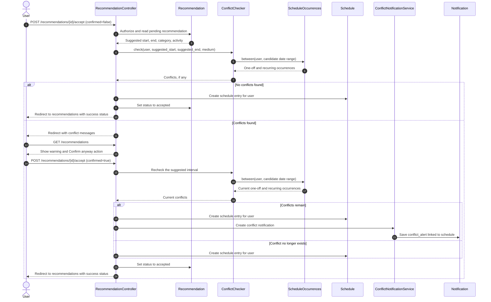

# Recommendation Conflict Flow

This sequence reflects the implemented recommendation acceptance flow in `RecommendationController::accept`. The controller checks the suggested interval against one-off and recurring schedule occurrences before saving it.

Direct schedule creation and updates use the same check, warning, and recheck pattern through `ScheduleController`. When the user confirms an entry while conflicts remain, the app saves the entry and creates a linked `conflict_alert` notification.
