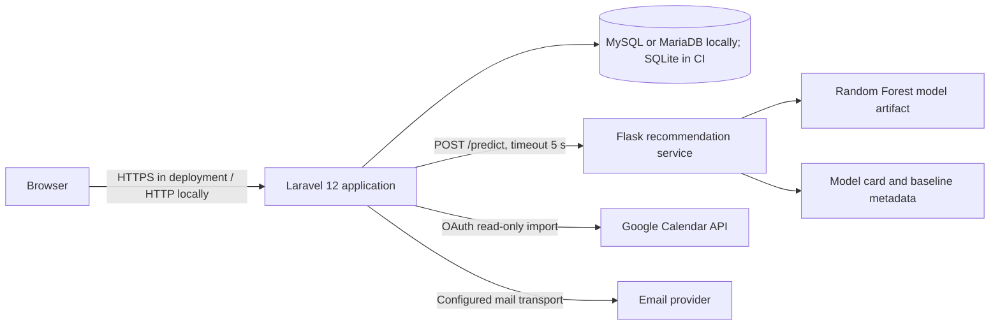

# System Architecture and Technical Setup

This document describes the repository as implemented: its Laravel application, Python recommendation service, local development setup, data flow, test commands, and known model and deployment limitations. For the current Azure VM deployment, see the [Azure VM deployment runbook](azure-vm-deployment.md). It contains configuration variable names only; never put credentials or real user data in documentation.

## Architecture



Laravel owns authentication, authorization, validation, schedule persistence, conflict handling, notification delivery, and Google Calendar token storage. Flask ranks candidate time slots; it does not create or modify schedules. MySQL or MariaDB is the expected local database configuration; CI uses SQLite. The Flask service is a separate local process in development and should be kept on a private network in deployment.

## Repository map

- `web/` — Laravel application (PHP, Blade, Vite, Tailwind, Chart.js).
- `ml/slot-recommender/` — Flask API, ATUS preparation/training scripts, model metadata, and tests.
- `docs/` — user, integration, deployment, performance, and project documentation.
- `.github/workflows/ci.yml` — repository sanity, Laravel, and ML test jobs.

The no-show recommender is planned and is not part of the running scheduling flow.

## Request and data flow

When a signed-in user requests recommendations, Laravel gathers the task category, weekday (Monday is `0`), duration in minutes, schedule density, and hours since the same category was last scheduled. Laravel calls the configured Flask URL at `/predict` with a five-second timeout. Flask evaluates candidate hours, using the trained classifier and completion lookup, and returns up to three suggestions with confidence and suitability data. Laravel presents the results and remains responsible for checking the user's schedule, enforcing ownership, resolving conflicts, and persisting any confirmed schedule.

The recommender's `/health` endpoint reports whether a model is loaded. `/predict` returns a client error for invalid request JSON and a service-unavailable response when model artifacts are unavailable. `/retrain` is protected by `ML_RETRAIN_KEY` in the `X-API-Key` header. Retraining is synchronous, so this endpoint should not be exposed publicly. The prediction route has no independent authentication; restrict access to the Flask service at the network layer.

Google Calendar integration uses a read-only OAuth scope. Laravel stores OAuth tokens encrypted using `APP_KEY`. Imports are limited to a 31-day range; duplicate events are skipped. All-day events and events spanning local calendar days are not supported by the current importer. See [Google Calendar OAuth and import](google-calendar-oauth.md).

Email delivery depends on Laravel's configured mail transport. The default `MAIL_MAILER=log` writes messages to the application log and does not deliver them to an inbox. Set up a real provider for delivery.

## Runtime requirements

| Component | Requirements from project configuration |
|---|---|
| Laravel | PHP `^8.2`, Laravel `^12.0`; Composer dependencies |
| Frontend assets | Node.js `>=22.12.0`; npm dependencies in `web/package.json` |
| Database | MySQL/MariaDB for the local configuration; SQLite is used in CI |
| Recommender | Python 3.11 is used in CI; Flask, pandas, NumPy, scikit-learn, and joblib |
| ML development | Optional packages in `requirements-dev.txt`, including pytest and notebook tools |

Check installed versions with `php -v`, `composer --version`, `node --version`, `npm --version`, and `py --version` (Windows) or `python3 --version` (macOS/Linux).

## Local setup

### Laravel web application (Windows PowerShell)

From the repository root:

```powershell
cd web
composer install
Copy-Item .env.example .env  # only if .env does not already exist
php artisan key:generate     # only for a new local APP_KEY
```

Configure the local database values in `.env`, then create/update the schema:

```powershell
php artisan migrate
php artisan storage:link
npm.cmd ci
npm.cmd run build
php artisan serve
```

Open `http://127.0.0.1:8000`. Run the Vite development server in a second terminal with `cd web; npm.cmd run dev` when editing frontend assets. Do not replace an existing `.env` or regenerate its `APP_KEY` on an established local installation: doing so can invalidate encrypted OAuth tokens. Use migrations against an existing database; the default seeder creates a fixed test email and can fail on repeated runs due to the unique email constraint.

Set `SLOT_RECOMMENDER_URL` to the Flask service URL (default `http://127.0.0.1:5001`). For Google Calendar, configure `GOOGLE_CALENDAR_CLIENT_ID`, `GOOGLE_CALENDAR_CLIENT_SECRET`, and `GOOGLE_CALENDAR_REDIRECT_URI`. Configure mail settings such as `MAIL_MAILER`, host, credentials, and sender using your chosen provider. Keep secrets in the local environment, never in Git.

### Slot recommender

In a separate PowerShell terminal:

```powershell
cd ml/slot-recommender
py -3.11 -m venv .venv
.\.venv\Scripts\Activate.ps1
python -m pip install -r requirements-dev.txt
```

The development requirements include serving, training, tests, and notebook packages. The training pipeline requires the ATUS 2023 Activity and Respondent source files under `data/raw/`. Follow `ml/slot-recommender/README.md` for the approved source and exact filenames. Prepare data and train the local model:

```powershell
python src/load_atus.py
python src/negatives.py
python src/train.py
python app/api.py
```

The API listens at `http://127.0.0.1:5001`. In a third terminal, verify it with `Invoke-RestMethod http://127.0.0.1:5001/health`. Training creates model artifacts locally; the large serialized model is intentionally not committed. `models/model_card.json` and `models/baselines.json` document the model metadata and validation results.

## Configuration and sensitive values

| Variable | Purpose |
|---|---|
| `APP_KEY` | Laravel encryption and signed application data; keep stable and private |
| `DB_*` | Local database connection settings |
| `SLOT_RECOMMENDER_URL` | Private Flask API base URL |
| `GOOGLE_CALENDAR_CLIENT_ID`, `GOOGLE_CALENDAR_CLIENT_SECRET`, `GOOGLE_CALENDAR_REDIRECT_URI` | Google OAuth client configuration |
| `MAIL_*` | Mail transport and sender configuration |
| `ML_RETRAIN_KEY` | Shared secret required for Flask model retraining |

Never commit `.env`, OAuth client secrets, API keys, access tokens, or real user data. The repository CI sanity job rejects tracked `.env` files, the local-only `docs/PROJECT_LOG.md`, and files larger than 50 MB. See [Production security checklist](production-security.md) before deployment.

## Model result and limitations

The business target in the modeling documentation is F1 greater than `0.75`. The committed `baselines.json` records Random Forest validation F1 of `0.7246`, Hit Rate@3 of `0.3612`, and MAE of `3.682` hours. The validation F1 is about `0.0254` (2.54 percentage points) below the target, so the target was not met. `model_card.json` reports cross-validation F1 of `0.7299`; that is a separate metric and must not be described as a held-out test result. The committed results do not provide a distinct held-out test-set F1 value.

The training data comes from the U.S. American Time Use Survey, with one diary day per respondent. “Not suitable” is a proxy label meaning the respondent was doing another activity at that time, not that they would reject a recommendation. Survey weights are not used. The model has not been shown to generalize to Wasaa users in Kenya or other populations; in-app completion data is intended to support personalization, but that does not establish measured improvement yet. See the CRISP-DM reports in `ml/slot-recommender/docs/` for methodology and comparisons.

## Tests and CI

Run the application tests from `web/`:

```powershell
php artisan test
```

Run the recommender tests from `ml/slot-recommender/` with its virtual environment activated:

```powershell
python -m pytest
```

Build frontend assets from `web/` with `npm.cmd run build`. GitHub Actions runs the repository sanity checks, Laravel tests on PHP 8.2 with SQLite, and recommender tests on Python 3.11. The workflow does not currently run the frontend build. Manual browser acceptance checks are described in the [User Manual](user-manual.md) and UAT/SUS plan.

## Related documentation

- [Documentation index](README.md)
- [User Manual](user-manual.md)
- [Laravel–Flask integration tests](laravel-flask-integration-tests.md)
- [Performance benchmark](performance-benchmark.md)
- [Google Calendar OAuth and import](google-calendar-oauth.md)
- [Production security checklist](production-security.md)
