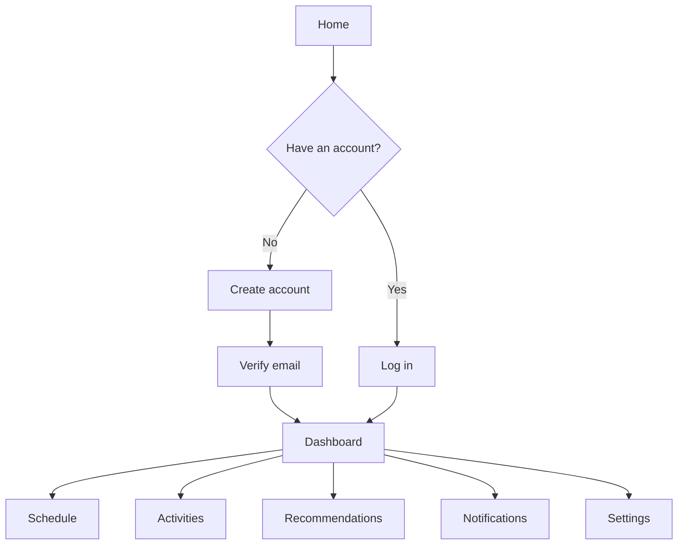

# WasaaLifestyle User Manual

WasaaLifestyle helps you plan tasks and routines around your schedule, review suggested times, and keep track of activity progress.

## Create an account or sign in

1. Open the WasaaLifestyle website.
2. Select **Create an account** and enter your name, email address, password, and password confirmation, or select **Log in** if you already have an account. If you forgot your password, choose **Forgot password?** on the login page and submit your account email. If it matches an account, Wasaa sends a time-limited reset link; the confirmation message is the same whether or not the email is registered.
3. After registration, check your email and follow the verification link. You must verify your email before using your schedule and account pages.
4. If the verification message does not arrive, check your spam folder. On the **Verify your email** page, select **Resend verification email**. Contact your administrator if it still does not arrive.

If you are signed in, the navigation links are in the left sidebar on desktop. On a small screen, use the menu button in the top bar. Your profile menu is at the top right.
To sign out, open the profile menu and select **Log out**.

## Dashboard

The **Dashboard** gives you a short view of the next seven days, pending recommendations, and unread notifications. Select **Add to my week** or **Create a task** to add a schedule entry. Select **View full schedule** to open the schedule views, or **Open activities** to review your routines and progress.

## Activities

Activities are the routines you want to keep track of and use for scheduling suggestions.

1. Open **Activities** and select **Add activity**.
2. Enter an **Activity Name**, **Category**, **Preferred Time**, **Frequency (times per week)**, and **Duration (minutes)**. Save the activity.
3. To change or remove an activity, select its name in the list. Select **Save Changes** to keep edits, or **Delete activity** to remove it and its history.
4. In the **Log Today** column, select **Done**, **Missed**, or **Skip** for each activity. The most recently selected status is the status recorded for today.
5. Select **Get recommendation** beside an activity to request suggested schedule times. Open **Recommendations** to review them.

The activity list also shows preferred time, frequency, duration, streak, and recent history. Its chart summarizes activity completion over the past seven days.

## Schedule

Open **Schedule** to see upcoming tasks and events. Use **List view**, **Day view**, and **Week view** to change how you browse your schedule. Select a schedule entry to edit it.

To add a task, select **New task** or **Add to my week** and enter:

- **Task Title**, **Date**, **Start Time**, and **End Time**
- **Category** and **Priority**
- **Recurrence**: None, Daily, or Weekly
- An optional **Description**

Select **Save Task**. To edit an entry, select it and use **Save Changes**. Use **Delete entry** on the edit page to remove it.

### Schedule conflicts

Wasaa checks a new or changed time against your existing one-off and recurring entries. If it finds an overlap, the page lists the conflicting entries. Adjust the date or time and save again, or submit again to save despite the conflict. Confirm only when you intend to keep both entries. A confirmed conflict can also create an alert in **Notifications**.

## Recommendations

Open **Recommendations** to review pending suggested times. Each suggestion shows the activity, proposed date and time, and a confidence score.

- Select **Accept suggestion** to add the suggested time to your schedule.
- Select **Dismiss** to remove a suggestion you do not want.
- If the suggestion overlaps your schedule, review the warning. Change your schedule if needed, or select **Confirm anyway** to accept the overlap intentionally.

If no recommendations are listed, open **Activities** and select **Get recommendation** beside an activity. If Wasaa reports that recommendations are unavailable, try again later or schedule the activity manually.

## Notifications

Open **Notifications** to see schedule and account updates. Select **Mark as read** on one item or **Mark all as read** to clear all unread indicators. If a notification links to a schedule entry, select its title to open that entry.

## Settings

Open **Settings** in the sidebar, or use the profile menu at the top right and select **Account settings**.

### Profile and photo

In **Personal details**, update your name or email address and select **Save profile**. To add or replace your profile photo, choose a JPG, PNG, or WebP image up to 2 MB. Use **Remove current photo** to remove an existing photo, then save the profile.

### Password

Open **Change password**, enter your current password, enter a new password, and confirm it. New passwords must be at least eight characters and include letters and numbers. Select **Update Password**. If you have forgotten your password, use **Forgot password?** on the login page and follow the reset link sent to your account email.

### Availability and preferences

- Under **Weekly Availability Windows**, choose the morning, afternoon, and evening periods when Wasaa may schedule tasks for each day.
- Under **Productivity Preferences**, set your peak start and end hours and preferred break duration.
- Under **Notification Alerts**, choose whether to receive schedule conflict, daily summary, and recommendation alerts.
- Select **Save preferences** to save these changes. Email alert delivery also depends on the website's email service being configured by its administrator.

### Dark mode

Use the theme button in the top bar to switch between light and dark mode. Your choice is saved in this browser and remains selected when you return to the site.

### Google Calendar

The **Google Calendar** section shows whether a calendar is connected. Select **Connect Google Calendar** and follow Google's authorization steps. Wasaa requests read-only event access; it cannot edit your Google Calendar. Select **Disconnect Google Calendar** to remove the connection.

If the page says the connection is not configured, contact the administrator. If Google revokes a connection, connect the calendar again in Settings.

## Import Google Calendar events

After connecting a calendar:

1. Open **Schedule** and select **Import calendar**.
2. Choose **From** and **Through** dates (up to 31 days) and a **Category for imported events**.
3. Select **Review events**. Check the date range, duplicates, conflicts, and unsupported events before saving anything.
4. Select **Confirm and import N event(s)** to import the listed supported events, or **Change date range** to go back.

Wasaa skips events already imported. All-day events and timed events that cross into another local calendar day are listed as unsupported. If your Wasaa schedule changes while the review is open, review the updated conflict summary before confirming again. Imported events do not change your Google Calendar.

For technical connection setup, see [Google Calendar OAuth and import](google-calendar-oauth.md).

## Delete your account

The **Delete account** section is at the bottom of Settings. This permanently deletes your account and associated Wasaa schedules, activities, recommendations, notifications, and connected calendar credentials.

To proceed, open **Delete account**, type `DELETE`, enter your current password, and select **Permanently Delete Account**. This action cannot be undone. If you only want to disconnect your Google Calendar, use **Disconnect Google Calendar** instead.

## Common problems

| Problem | What to do |
| --- | --- |
| Login is rejected | Check your email and password. If your email is not verified, use the verification page. If the account is suspended, contact the administrator. |
| Forgot your password | Choose **Forgot password?** on the login page and check the inbox for the address you submitted, including the spam folder. Reset links expire; request another link if needed. |
| Verification or notification email is missing | Check spam, use **Resend verification email** when available, and contact the administrator if it still does not arrive. Email delivery depends on server configuration. |
| A task overlaps another entry | Review the listed conflict, change the time, or submit again only if you intend to keep the overlap. |
| No recommendations appear | Open **Activities** and select **Get recommendation**. If recommendations are temporarily unavailable, try later or schedule manually. |
| Calendar connection is unavailable | Contact the administrator if Settings says it is not configured. If a connection was revoked, reconnect it from Settings. |
| Calendar events are missing from the preview | Check the selected date range and the unsupported-events list. All-day and cross-day timed events are not imported. Use a shorter date range if the preview reports more than 500 events. |
| Profile photo is rejected | Use a JPG, PNG, or WebP file no larger than 2 MB. |
| You cannot access your schedule after registration | Complete email verification first. Use **Resend verification email** if needed. |

For a detailed explanation of how conflict warnings and confirmations work, see [Recommendation conflict flow](conflict-flow.md). For account or service problems you cannot resolve, contact your WasaaLifestyle administrator.
