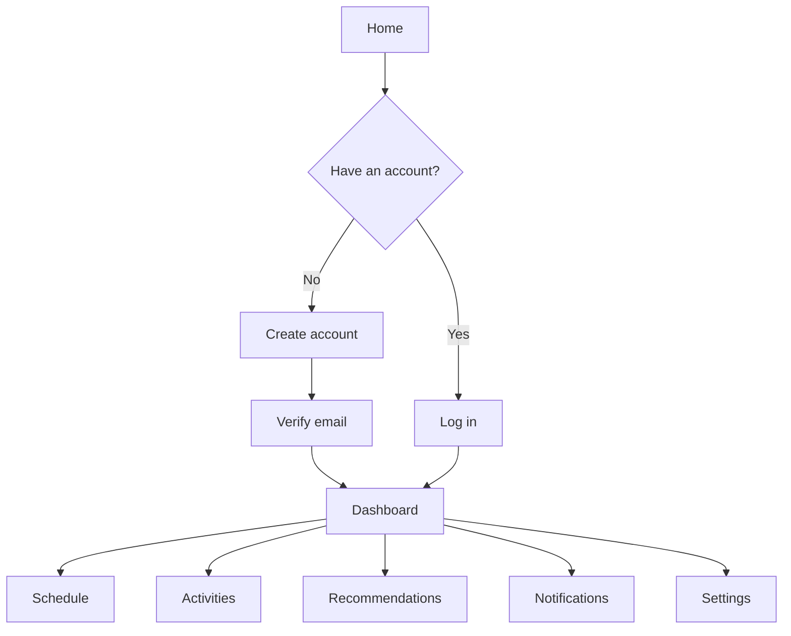

# WasaaLifestyle User Manual

WasaaLifestyle helps you plan tasks and routines around your schedule, review suggested times, and keep track of activity progress.

## Create an account or sign in

1. Open the WasaaLifestyle website.
2. Select **Create an account** and enter your name, email address, password, and password confirmation, or select **Log in** if you already have an account. If you forgot your password, choose **Forgot password?** on the login page and submit your account email. If it matches an account, Wasaa sends a time-limited reset link; the confirmation message is the same whether or not the email is registered.
3. After registration, check your email and follow the verification link. You must verify your email before using your schedule and account pages.
4. If the verification message does not arrive, check your spam folder. On the **Verify your email** page, select **Resend verification email**. Contact your administrator if it still does not arrive.

If you are signed in, the navigation links are in the left sidebar on desktop. On a small screen, use the menu button in the top bar. Your profile menu is at the top right.
To sign out, open the profile menu and select **Log out**.

## Dashboard

The **Dashboard** gives you a short view of the next seven days, pending recommendations, and unread notifications. Select **Add to my week** or **Create a task** to add a schedule entry. Select **View full schedule** to open the schedule views, or **Open activities** to review your routines and progress.

## Activities

Activities are the routines you want to keep track of and use for scheduling suggestions.

1. Open **Activities** and select **Add activity**.
2. Enter an **Activity Name**, **Category**, **Preferred Time**, **Frequency (times per week)**, and **Duration (minutes)**. Select **Generate weekly recommendations** to get suggested days and up to three suitable times for each session.
3. Choose a recommended time for every session. You can ask for more times for a day or change the day and get recommendations for that day. Each weekly session must use a different day. Save the activity and plan together.
4. The saved plan repeats weekly for up to one year. To change it, select the activity name or **Edit weekly plan**. Change any session's day or time, request alternatives, then save. Removing the activity removes its linked routine entries and history.
5. In the **Log Today** column, select **Done**, **Missed**, or **Skip** for each activity. The most recently selected status is the status recorded for today.

The activity list shows each saved weekly day and time, frequency, duration, streak, and recent history. Its chart summarizes activity completion over the past seven days.

## Schedule

Open **Schedule** to see upcoming tasks and events. Use **List view**, **Day view**, and **Week view** to change how you browse your schedule. Select a schedule entry to edit it.

To add a task, select **New task** or **Add to my week** and enter:

- **Task Title**, **Date**, **Start Time**, and **End Time**
- **Category** and **Priority**
- **Recurrence**: Choose **None** for a one-time task, **Daily** to repeat every day, or **Weekly** to choose a weekday and repeat from its first occurrence on or after the start date. A repeating task must end within one year of its first occurrence, either **On a date** or **After a number of occurrences**. The occurrence count includes the first one.
- An optional **Description**

Select **Save Task**. To edit an entry, select it and use **Save Changes**. Use **Delete entry** on the edit page to remove it.

### Schedule conflicts

Wasaa checks a new task against your existing schedule. Recommendations for repeating tasks must fit your availability and avoid clashes throughout the selected repeat period. If a one-time event conflicts with one activity occurrence, Wasaa saves the rest of the weekly routine and skips that occurrence. A clash that repeats across multiple dates must be resolved by choosing another time or day. Existing repeating tasks created without an end date remain scheduled; editing one requires choosing a finite end. New events added later are checked against repeating tasks when they are saved.

## Recommendations

Open **Recommendations** to review upcoming task and lifestyle activity times. Each suggestion names the scheduled item and shows its current date and time, proposed date and time, reason, and confidence score.

- Select **Apply recommended change** to move the item. Wasaa shows a success message with the item and its old and new times.
- For a repeating entry, only the selected occurrence changes; the other occurrences remain scheduled. The replacement for a lifestyle activity remains linked to that activity and is used as that day's planned time when logging it.
- Select **Dismiss** to remove a suggestion you do not want.
- If the proposed time overlaps your schedule, review the conflict warning. Change your schedule if needed, or select **Apply anyway** to accept the overlap intentionally.

Use **Activities** for repeatable routines such as exercise or studying. During setup or editing, Wasaa recommends a plan for the next seven days based on the activity's weekly frequency. It chooses separate days where possible and shows up to three time options, each with a confidence score, for every session. Saving the activity schedules all chosen sessions as a weekly routine for up to one year. A one-off event belongs in **Schedule** instead.

For a one-off task on a particular day, open **Schedule** and choose **New task**. Expand **Looking for a time on a specific date?** at the bottom of the time guide, choose a date in the calendar, and select **Find times for this date**. The chosen date is copied into **Task details**. Wasaa finds times for that date using its weekday availability, the task duration, and schedule conflicts. Pick a suggested time to update the form, review it, and save.

## Notifications

Open **Notifications** to see schedule and account updates. Select **Mark as read** on one item or **Mark all as read** to clear all unread indicators. If a notification links to a schedule entry, select its title to open that entry.

## Settings

Open **Settings** in the sidebar, or use the profile menu at the top right and select **Account settings**.

### Profile and photo

In **Personal details**, update your name or email address and select **Save profile**. To add or replace your profile photo, choose a JPG, PNG, or WebP image up to 2 MB. Use **Remove current photo** to remove an existing photo, then save the profile.

### Password

Open **Change password**, enter your current password, enter a new password, and confirm it. New passwords must be at least eight characters and include letters and numbers. Select **Update Password**. If you have forgotten your password, use **Forgot password?** on the login page and follow the reset link sent to your account email.

### Availability and preferences

- Under **Weekly Availability Windows**, add one or more **From** and **To** time ranges for each day. You can remove every range on a day when you are unavailable. Ranges on the same day cannot overlap, and each range must end later than it starts.
- Under **Productivity Preferences**, set your peak start and end hours and preferred break duration. Recommendations use available ranges, suggest starts every 30 minutes, and rank available times inside your peak hours first. A task must fit fully inside one available range.
- Under **Notification Alerts**, turn on **Personalize time recommendations** to let Wasaa use your completed and missed outcomes for your recommendations. After at least 120 outcomes, it tests a model trained on your history and uses it only if it performs better than the general model. Otherwise, your history adjusts the general suggestions. Your outcomes are not pooled with other users; turning this setting off stops their use for recommendations.
- Under **Notification Alerts**, choose whether to receive schedule conflict and recommendation alerts. Daily schedule summary emails are no longer offered.
- Select **Save preferences** to save these changes.

### Dark mode

Use the theme button in the top bar to switch between light and dark mode. Your choice is saved in this browser and remains selected when you return to the site.

### Google Calendar

The **Google Calendar** section shows whether Google Calendar and Tasks are connected. Select **Connect Google Calendar** and follow Google's authorization steps. Wasaa requests read-only access; it cannot change items in Google. Select **Disconnect Google Calendar** to remove the connection. If Settings asks you to reconnect for Tasks, use that link to grant the new read-only permission.

If the page says the connection is not configured, contact the administrator. If Google revokes a connection, connect the calendar again in Settings.

## Import Google Calendar events and tasks

After connecting a calendar:

1. Open **Schedule** and select **Import calendar**.
2. Choose **From** and **Through** dates (up to 31 days), then select **Review items**.
3. On the review screen, choose a category for each new event or task. Check the date range, duplicates, conflicts, and unsupported items before saving anything.
4. Select **Confirm and import N item(s)** to import the listed supported items, or **Change date range** to go back.

Wasaa imports Calendar events and Google Tasks with due dates in the selected range. Untimed tasks and all-day events display as all-day entries; timed events spanning dates appear on each affected day. Wasaa skips already imported items. If your Wasaa schedule changes while the review is open, review the updated conflict summary before confirming again. Imports do not change your Google account. The administrator must enable the Google Tasks API, and existing Google connections may need to be reauthorized to grant read-only Tasks access.

For technical connection setup, see [Google Calendar OAuth and import](google-calendar-oauth.md).

## Delete your account

The **Delete account** section is at the bottom of Settings. This permanently deletes your account and associated Wasaa schedules, activities, recommendations, notifications, and connected calendar credentials.

To proceed, open **Delete account**, type `DELETE`, enter your current password, and select **Permanently Delete Account**. This action cannot be undone. If you only want to disconnect your Google Calendar, use **Disconnect Google Calendar** instead.

## Common problems

| Problem | What to do |
| --- | --- |
| Login is rejected | Check your email and password. If your email is not verified, use the verification page. If the account is suspended, contact the administrator. |
| Forgot your password | Choose **Forgot password?** on the login page and check the inbox for the address you submitted, including the spam folder. Reset links expire; request another link if needed. |
| Verification or notification email is missing | Check spam, use **Resend verification email** when available, and contact the administrator if it still does not arrive. Email delivery depends on server configuration. |
| A task overlaps another entry | Review the listed conflict, change the time, or submit again only if you intend to keep the overlap. |
| No activity times are recommended | Check the activity's duration and **Weekly Availability Windows** in Settings. If the recommendation service is temporarily unavailable, try again later or choose a time manually within your availability. |
| Calendar connection is unavailable | Contact the administrator if Settings says it is not configured. If a connection was revoked, reconnect it from Settings. |
| Calendar items are missing from the preview | Check the selected date range. Tasks must have a due date in that range. If tasks are missing, reconnect Google in Settings and ask the administrator to confirm the Google Tasks API is enabled. Use a shorter date range if the preview reports more than 500 items. |
| Profile photo is rejected | Use a JPG, PNG, or WebP file no larger than 2 MB. |
| You cannot access your schedule after registration | Complete email verification first. Use **Resend verification email** if needed. |

For a detailed explanation of how conflict warnings and confirmations work, see [Recommendation conflict flow](conflict-flow.md). For account or service problems you cannot resolve, contact your WasaaLifestyle administrator.
